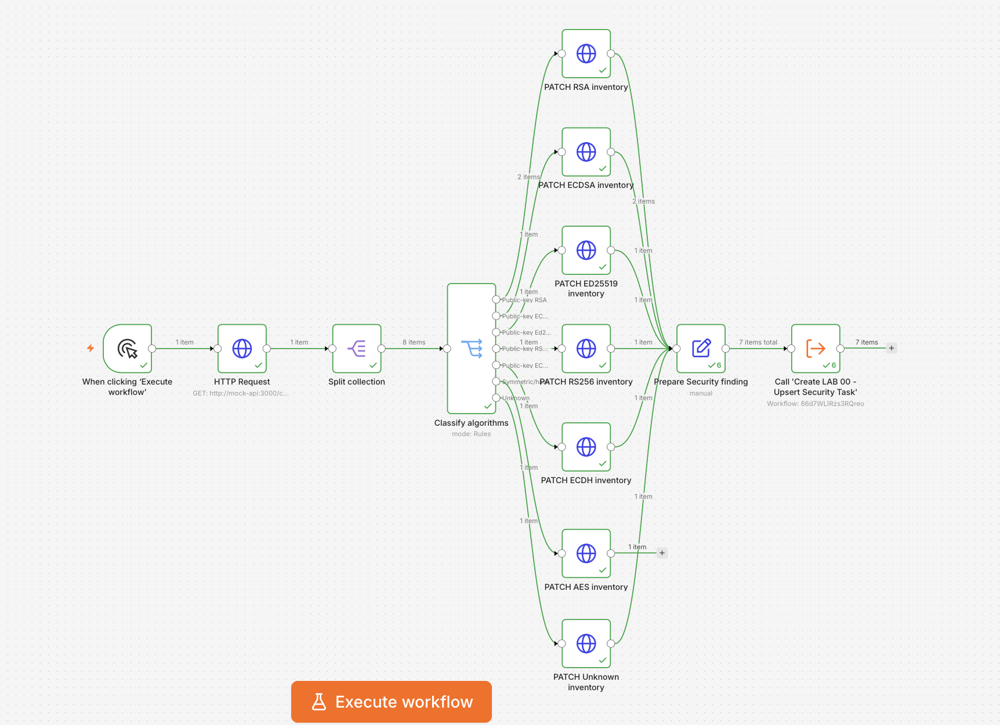
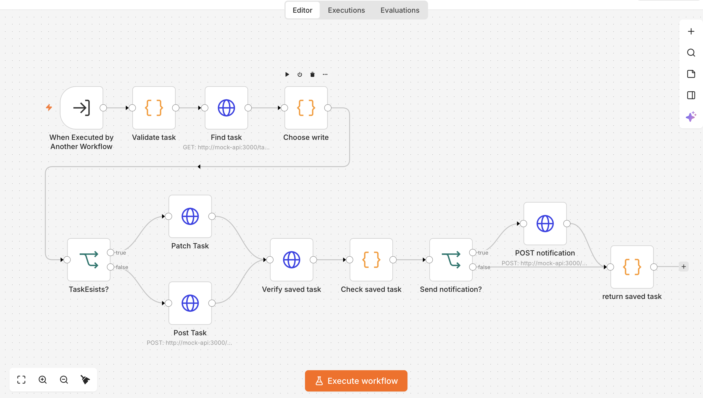

# TaskFlow Security Automation Lab

**Cryptographic Security Automation & Post-Quantum Cryptography (PQC) Readiness**

**Created by:** Shubham Uniyal  
**Project Guide:** TaskFlow Security Automation Lab Guide  
**Development Assistance:** AI Large Language Models (LLMs)  
**Project Status:** Work in Progress  
**Technologies:** n8n, Docker, Mockoon, REST APIs, JavaScript

## Project Overview

TaskFlow Security Automation Lab is a hands-on cybersecurity automation project created by Shubham Uniyal with assistance from AI Large Language Models (LLMs).

The project explores cryptographic asset discovery, security monitoring, automated task management, and post-quantum cryptography readiness using n8n, Docker, and Mockoon.

It demonstrates how automated workflows can retrieve security information, classify cryptographic algorithms, identify findings, create remediation tasks, prevent duplicate alerts, and track security-related changes.

## Important Disclaimer — Fictional Environment

**TaskFlow is an invented website and fictional application used exclusively for educational and simulation purposes.**

The TaskFlow website, its business environment, cryptographic assets, certificates, vendors, security findings, and incidents are simulated.

The website functions as a local demonstration dashboard, while Mockoon provides simulated REST API endpoints.

No real company infrastructure, production cryptographic keys, or customer systems are being scanned, monitored, or modified.

This project demonstrates cybersecurity automation concepts and is not a production-ready security monitoring platform.

## Current Development Progress

**Project Status:** Work in Progress

TaskFlow is an invented website and fictional security environment developed for educational purposes.

| Component | Status |
|---|---|
| Docker and Mockoon environment | Completed |
| TaskFlow simulated website and REST API | Working |
| LAB 00 — Upsert Security Task | Completed and tested |
| LAB 00 — Deduplication and priority escalation | Completed and tested |
| LAB 01 — Crypto Asset Discovery | Completed and tested |
| LAB 01 — Eight cryptographic asset assessments | Passed |
| LAB 01 — Seven automated security review tasks | Passed |
| LAB 01 — Duplicate prevention on rerun | Passed |
| LAB 02 — Certificate Expiry Automation | Next |
| LAB 03–08 | Planned |

## Completed Security Automation Workflows

### LAB 00 — Upsert Security Task

A reusable n8n workflow that validates security findings, creates or updates tasks, prevents duplicates, verifies stored information, and records simulated notifications.

**Testing:** New task creation, deduplication, priority escalation, and read-back verification completed successfully.

- [View LAB 00 Workflow](workflows/LAB-00-Upsert-Security-Task.json)
- [View LAB 00 Testing Documentation](docs/LAB-00-Testing.md)

### LAB 01 — Crypto Asset Discovery

An automated cryptographic inventory assessment workflow built with n8n's visual nodes.
### LAB 01 — Workflow Architecture

**Implementation:** Visual n8n workflow using HTTP Request,
Split Out, Switch, Edit Fields, and Execute Sub-workflow nodes.

**Verified Results:**
- 8 cryptographic assets assessed.
- 6 public-key-related assets flagged for review.
- 1 unknown-algorithm asset flagged for investigation.
- 1 AES asset assessed separately without a review task.
- 7 security review tasks created.
- No duplicate review tasks on repeated execution.

**Environment:** Fictional TaskFlow website and simulated Mockoon API.

- [View LAB 01 Workflow](workflows/LAB-01-Crypto-Asset-Discovery.json)
- [View LAB 01 Implementation and Testing](docs/LAB-01-Testing.md)

### Next Milestone

**LAB 02 — Certificate Expiry Automation**

The next workflow will evaluate certificate expiry dates, identify approaching or expired certificates, assign appropriate security priorities, and create or update remediation tasks through LAB 00.

*All TaskFlow assets, services, certificates, and security events are fictional and used only for controlled cybersecurity automation simulations.*

## LAB 00 — Upsert Security Task

This reusable n8n workflow automates security task creation,
duplicate prevention, priority escalation, and simulated notifications.

### Workflow Architecture

### Features

- Validates incoming security findings.
- Checks whether a matching task already exists.
- Creates new tasks using POST.
- Updates existing tasks using PATCH.
- Prevents duplicate security findings.
- Escalates task priorities when necessary.
- Generates simulated security notifications.
- Verifies task updates through API read-back.

**Testing Status:** Completed and verified using fictional TaskFlow data.

## Project Goals

- Discover and inventory simulated cryptographic assets.
- Identify algorithms requiring post-quantum security assessment.
- Generate and update security review tasks automatically.
- Avoid creating duplicate findings.
- Simulate security notifications and remediation workflows.
- Build reusable and maintainable automation components.
- Develop practical cybersecurity automation and PQC-readiness skills.

## Project Author

**Shubham Uniyal**

This project and its accompanying TaskFlow Security Automation Lab Guide were created by Shubham Uniyal with assistance from AI Large Language Models for research, technical guidance, documentation, and troubleshooting.

Development, workflow configuration, and testing progress are documented as the project evolves.
