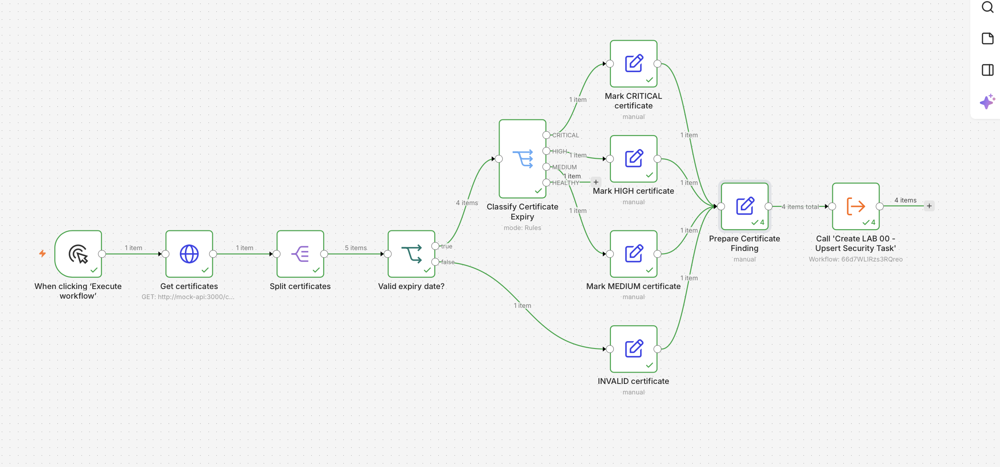
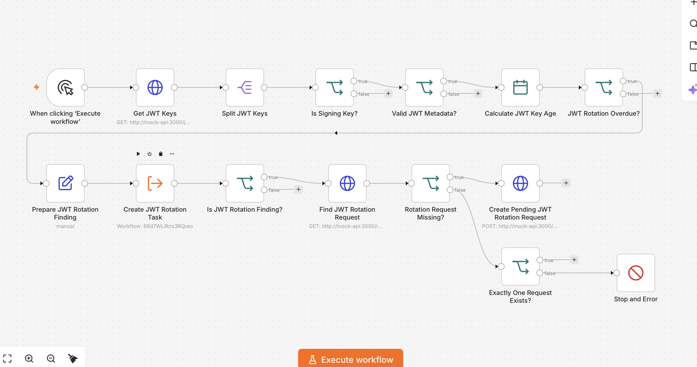
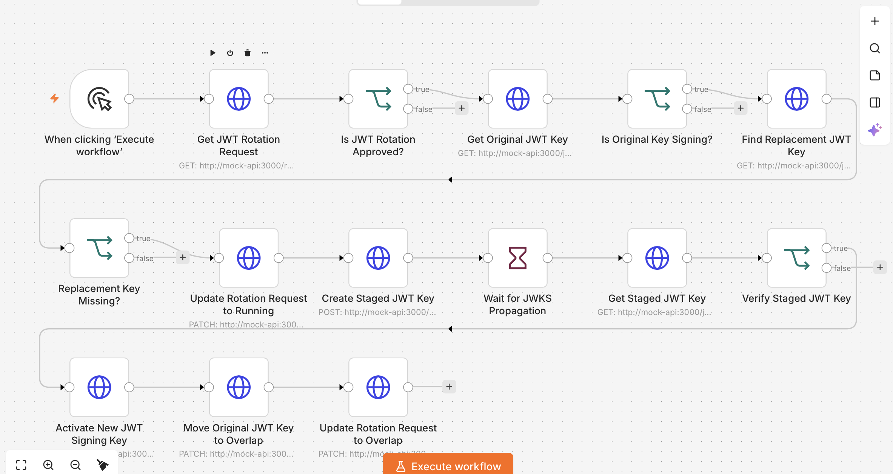
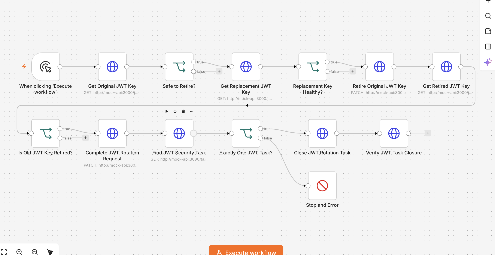
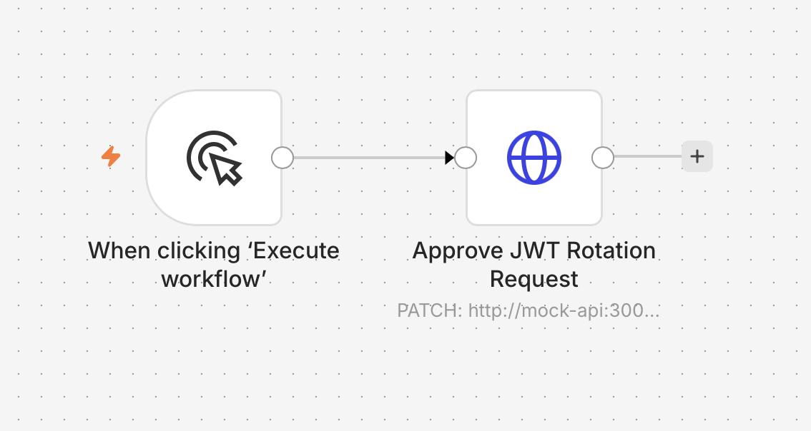
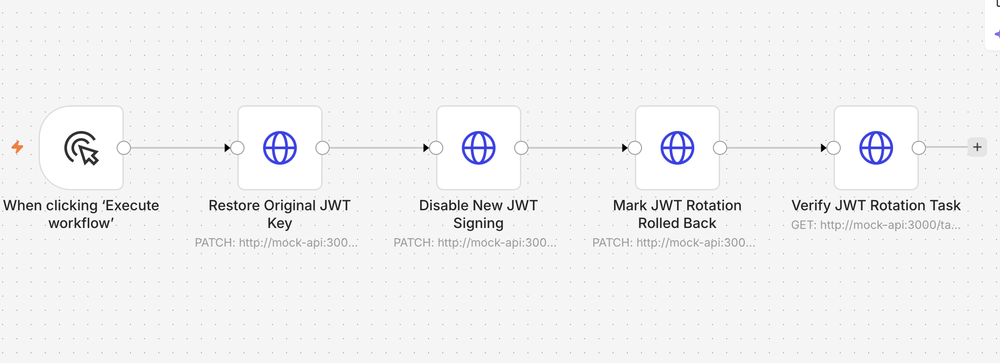

# TaskFlow Security Automation Lab

**Cryptographic Security Automation & Post-Quantum Cryptography (PQC) Readiness**

**Created by:** Shubham Uniyal  
**Project Guide:** [TaskFlow Security Automation Lab Guide (PDF)](docs/TaskFlow-Security-Automation-Lab-Guide.pdf)  
**Development Assistance:** AI Large Language Models (LLMs)  
**Project Status:** Work in Progress  
**Technologies:** n8n, Docker, Mockoon, REST APIs, JavaScript

---

## Project Overview

TaskFlow Security Automation Lab is a hands-on cybersecurity automation project created by Shubham Uniyal with assistance from AI Large Language Models (LLMs).

The project explores cryptographic asset discovery, security monitoring, automated task management, and post-quantum cryptography readiness using n8n, Docker, and Mockoon.

It demonstrates how automated workflows can retrieve security information, classify cryptographic algorithms, identify findings, create remediation tasks, prevent duplicate alerts, and track security-related changes.

The project includes an original technical guide, a local Docker and Mockoon starter environment, reference scripts, and implemented n8n workflows with testing documentation.

## Original Project Guide

The **TaskFlow Security Automation Lab Guide** was created by **Shubham Uniyal**, with assistance from AI Large Language Models (LLMs).

This guide provides the technical foundation and step-by-step instructions for building the fictional TaskFlow cybersecurity automation environment.

It covers Docker, Mockoon, n8n, cryptographic asset assessment, certificate monitoring, automated security tasks, and post-quantum cryptography readiness exercises.

The repository documents the actual implementation, testing, troubleshooting, and progress of the project.

**Implementation Status:** LAB 00, LAB 01, and LAB 02 are completed and tested. LAB 03 is implemented and exercised locally, with remaining validation improvements documented. LAB 04–08 are planned.

[Read the Complete TaskFlow Security Automation Lab Guide (PDF)](docs/TaskFlow-Security-Automation-Lab-Guide.pdf)

---

## Important Disclaimer — Fictional Environment

**TaskFlow is an invented website and fictional application used exclusively for educational and simulation purposes.**

The TaskFlow website, its business environment, cryptographic assets, certificates, vendors, security findings, and incidents are simulated.

The website functions as a local demonstration dashboard, while Mockoon provides simulated REST API endpoints.

No real company infrastructure, production cryptographic keys, or customer systems are being scanned, monitored, or modified.

This project demonstrates cybersecurity automation concepts and is not a production-ready security monitoring platform.

---

## Technologies Used

| Technology | Purpose |
|---|---|
| n8n | Security workflow automation |
| Docker | Local containerized environment |
| Docker Compose | Running connected services |
| Mockoon | Simulated REST API and data collections |
| JavaScript | Workflow logic and reference scripts |
| REST APIs | Retrieving and updating simulated records |
| JSON | Structured data and workflow exports |
| GitHub | Documentation and version control |

---

## Local Development Environment

The TaskFlow Local Docker and Mockoon Starter Kit provides the simulated infrastructure required to run the exercises.

### Repository Components

| Folder or File | Description |
|---|---|
| `TaskFlow-Local-Lab/compose.yaml` | Docker Compose configuration |
| `TaskFlow-Local-Lab/mockoon/` | Fictional TaskFlow website, API configuration, and seed data |
| `TaskFlow-Local-Lab/code/` | JavaScript reference scripts from the project guide |
| `TaskFlow-Local-Lab/examples/` | Simulated JSON records and API request examples |
| `TaskFlow-Local-Lab/events/` | Sample webhook event payloads |
| `TaskFlow-Local-Lab/practice/` | Beginner Mockoon practice exercises |
| `workflows/` | Completed n8n workflow exports |
| `docs/` | Project guide, setup instructions, and testing documentation |
| `screenshots/` | Workflow screenshots and visual evidence |

Scripts for future labs are reference material and do not indicate that those labs have been implemented or tested.

### Getting Started

1. Install Docker Desktop and Docker Compose.
2. Clone or download this GitHub repository.
3. Open Terminal and navigate into the starter-kit folder with `cd TaskFlow-Local-Lab` from the cloned repository root.
4. Check the Docker Compose configuration using `docker compose config`.
5. Start the local services using `docker compose up -d`.
6. Open n8n at `http://localhost:5678`.
7. Open the fictional TaskFlow website at `http://localhost:3000`.
8. Initialize the simulated records using the website's **Initialize / reset demo** button.
9. Follow the project guide to configure and test the n8n workflows.

**Important:** Initialize/reset replaces the mock records, so avoid using it when you need to preserve your existing test results. Follow the starter-kit instructions for saving and restoring your mock data.

For complete installation, Docker configuration, Mockoon setup, and n8n workflow instructions, refer to the [TaskFlow Security Automation Lab Guide (PDF)](docs/TaskFlow-Security-Automation-Lab-Guide.pdf).

The environment is designed for local educational use only. Its development settings should not be exposed to the public internet.

---

## Current Development Progress

**Project Status:** Work in Progress

| Component | Status |
|---|---|
| Docker and Mockoon environment | Completed |
| TaskFlow simulated website and REST API | Working |
| LAB 00 — Upsert Security Task | Completed and tested |
| LAB 00 — Deduplication and priority escalation | Passed |
| LAB 01 — Crypto Asset Discovery | Completed and tested |
| LAB 01 — Eight cryptographic asset assessments | Passed |
| LAB 01 — Seven automated security review tasks | Passed |
| LAB 01 — Duplicate prevention on rerun | Passed |
| LAB 02 — Certificate Expiry Automation | Completed and tested |
| LAB 02 — Certificate expiry classification | Passed |
| LAB 02 — Invalid expiry date detection | Passed |
| LAB 02 — Priority escalation (MEDIUM to CRITICAL) | Passed |
| LAB 02 — Certificate renewal verification | Passed |
| LAB 02 — Verified task closure | Passed |
| LAB 03 — JWT Key Rotation Simulator | Implemented and exercised locally; remaining validation work documented |
| LAB 03 — Overdue key detection and pending request | Reported pass |
| LAB 03 — Approval required before cutover | Reported pass |
| LAB 03 — Approved staging, signing cutover, and overlap | Reported pass |
| LAB 03 — Retirement and task closure | Reported pass for tested path; retirement deadline guard pending |
| LAB 03 — Staged-key health failure | User-reported completed |
| LAB 03 — Failure during overlap and manual rollback | Implemented/test scenarios described; final verification pending |
| LAB 04–08 | Planned |

---

## Completed Security Automation Workflows

### LAB 00 — Upsert Security Task

**Status: Completed and Tested**

A reusable n8n workflow that validates security findings, creates or updates tasks, prevents duplicates, verifies stored information, and records simulated notifications.

#### Workflow Architecture

#### Features

- Validates incoming security findings.
- Checks whether a matching task already exists.
- Creates new tasks using HTTP POST.
- Updates existing tasks using HTTP PATCH.
- Prevents duplicate security findings.
- Escalates task priorities when necessary.
- Generates simulated security notifications.
- Verifies task updates through API read-back.

#### Testing Results

| Test | Result |
|---|---|
| New task creation | PASS |
| Duplicate prevention | PASS |
| Priority escalation | PASS |
| Simulated notifications | PASS |
| Saved task verification | PASS |

**Testing Status:** Completed and verified using fictional TaskFlow data.

#### Project Files

- [View LAB 00 Workflow](workflows/LAB-00-Upsert-Security-Task.json)
- [View LAB 00 Testing Documentation](docs/LAB-00-Testing.md)

---

### LAB 01 — Crypto Asset Discovery

**Status: Completed and Tested**

An automated cryptographic inventory assessment workflow built with n8n's visual nodes.

The workflow retrieves simulated cryptographic assets, classifies their algorithm labels, updates their assessment records, and generates security review tasks through LAB 00.

#### Workflow Architecture

#### Implementation

Visual n8n workflow using Manual Trigger, HTTP Request, Split Out, Switch, Edit Fields, and Execute Sub-workflow nodes.

The implemented LAB 01 uses visual routing and n8n expressions rather than standalone JavaScript Code nodes for classification.

#### Verified Results

- 8 cryptographic assets assessed.
- 6 public-key-related assets flagged for review.
- 1 unknown-algorithm asset flagged for investigation.
- 1 AES asset assessed separately without a review task.
- 7 security review tasks created.
- No duplicate crypto-review tasks created on repeated execution.

#### Testing Results

| Test | Result |
|---|---|
| Inventory retrieval | PASS |
| Eight assets processed | PASS |
| Algorithm classification | PASS |
| Inventory assessment updates | PASS |
| Seven security review tasks created | PASS |
| AES excluded from review task creation | PASS |
| Duplicate prevention on rerun | PASS |

**Environment:** Fictional TaskFlow website and simulated Mockoon API.

These classification rules are designed for the sample dataset and do not constitute a comprehensive cryptographic security assessment.

#### Project Files

- [View LAB 01 Workflow](workflows/LAB-01-Crypto-Asset-Discovery.json)
- [View LAB 01 Implementation and Testing](docs/LAB-01-Testing.md)

---

### LAB 02 — Certificate Expiry Automation

A visual n8n security automation workflow that monitors simulated certificate expiration dates and generates prioritized security findings.

#### Workflow Architecture

**Key capabilities:**
- Detects expiring and expired certificates.
- Classifies findings as CRITICAL, HIGH, or MEDIUM.
- Flags invalid certificate expiration dates.
- Prevents duplicate security tasks through LAB 00.
- Supports priority escalation when expiration becomes urgent.
- Demonstrates certificate renewal verification and manual task closure.

**Implementation:** n8n, Docker, Mockoon, REST API, IF, Switch, Edit Fields, and Execute Sub-workflow nodes.

**Project files:**
- [LAB 02 Workflow](workflows/LAB-02-Certificate-Expiry-Automation.json)
- [LAB 02 Testing and Validation](docs/LAB-02-Testing.md)
- [LAB 02 Workflow Screenshot](screenshots/LAB-02-Workflow-Overview.png)

**Status:** Completed and tested using fictional local-lab data.

---

### LAB 03 — JWT Key Rotation Simulator

**Status: Implemented and Tested Locally — Validation Improvements Pending**

A visual n8n security automation exercise that detects overdue JWT signing keys and simulates a controlled, approval-gated key rotation using fictional metadata.

The lab uses LAB 00 for security task management and separates rotation into detection, manual approval, approved cutover, retirement, and non-compromise rollback workflows.

#### Workflow Architecture

LAB 03 consists of five visual n8n workflows for JWT rotation detection, manual approval, cutover, retirement, and rollback.

**LAB 03A — Detect JWT Rotation**

**LAB 03B — Approved JWT Cutover**

**LAB 03C — Retire JWT Key**

**LAB 03 — Manual JWT Approval**

**LAB 03 — Manual JWT Rollback**

#### Features

- Detects signing keys that exceed their configured rotation policy.
- Validates key creation dates and rotation policy metadata.
- Creates HIGH-priority security findings through LAB 00.
- Prevents duplicate rotation requests using an existing-record check.
- Requires a separate manual approval before simulated signing changes.
- Stages replacement key metadata and checks publishing and consumer health.
- Preserves original-key verification during the overlap stage.
- Performs retirement read-back checks before recording completion.
- Finds the matching security task and updates its closure information.
- Includes approval-refusal, health-failure, and simulated rollback exercises.

**Implementation:** n8n Manual Trigger, HTTP Request, IF, Split Out, Date & Time, Edit Fields, Wait, Execute Sub-workflow, and Stop and Error nodes. The implemented workflows use visual nodes and short n8n field expressions rather than standalone Code nodes.

#### Testing Results

| Test | Result |
|---|---|
| Overdue JWT key detection and pending request | Reported PASS |
| Approval gate refusal without approval | Reported PASS |
| Approved staging, cutover, and verification overlap | Reported PASS |
| Original-key retirement and task closure | Reported PASS for exercised path; deadline guard pending |
| Staged replacement health failure | User-reported completed |
| Replacement health failure during overlap | Final verification not documented |
| Manual rollback and saved-state verification | Workflow implemented; final verification pending |

#### Remaining Validation Work

- Add and test the missing `retireAfter` deadline comparison in LAB 03C before claiming the required overlap time is enforced.
- Confirm and save the five-second Wait configuration in LAB 03B.
- Add stronger saved-state assertions after cutover, task closure, and rollback.
- Extend LAB 03A's invalid-metadata branch to create a separate data-quality finding.

**Important:** These exercises use simulated JWT metadata only. No private keys are generated, no real tokens are signed, and no production authentication system is changed. The implementation does not perform a PQC migration.

#### Project Files

- [View LAB 03A — Detect JWT Rotation](workflows/LAB-03A-Detect-JWT-Rotation.json)
- [View LAB 03B — Approved JWT Cutover](workflows/LAB-03B-Approved-JWT-Cutover.json)
- [View LAB 03C — Retire JWT Key](workflows/LAB-03C-Retire-JWT-Key.json)
- [View LAB 03 — Manual Approval](workflows/LAB-03-Manual-Approval.json)
- [View LAB 03 — Manual Rollback](workflows/LAB-03-Manual-Rollback.json)
- [View LAB 03 Implementation and Testing](docs/LAB-03-Testing.md)

**Workflow screenshots:** Included above as links to the images stored in the repository's `screenshots/` folder. The public workflow exports have installation-specific metadata removed; the LAB 00 sub-workflow reference in LAB 03A must be reselected after import.

---

## Next Milestone — LAB 04

### LAB 04 — PQC Readiness Scanner

The next phase focuses on evaluating the post-quantum cryptography readiness of simulated services using ordered migration evidence and documented blockers.

**Planned capabilities:**
- Retrieve simulated service records and inspect cryptographic scope, ownership, evidence, and blockers.
- Assess evidence in order: inventory, roadmap, test environment, hybrid/PQC testing, and production migration.
- Assign an evidence-based readiness stage rather than a security percentage.
- Identify vendor dependencies and missing migration steps.
- Save readiness assessments to the simulated service records.
- Create next-step review tasks through the reusable LAB 00 workflow.
- Verify the sample service stages and corresponding review tasks after a fresh initialization.

**Status:** Planned — not yet implemented or tested.

---

## Project Goals

- Discover and inventory simulated cryptographic assets.
- Identify algorithms requiring post-quantum security assessment.
- Generate and update security review tasks automatically.
- Avoid creating duplicate findings.
- Simulate security notifications and remediation workflows.
- Build reusable and maintainable automation components.
- Develop practical cybersecurity automation and PQC-readiness skills.
- Document implementation, troubleshooting, and testing progress.

---

## Project Limitations

This project operates entirely within a fictional, locally simulated environment.

The workflows do not perform production cryptographic scanning, real key rotation, live certificate replacement, or verified post-quantum cryptography deployment.

Security classifications and remediation tasks are educational simulations.

Future workflows and reference scripts should not be considered completed implementations until they are separately configured and tested.

---

## Project Author

**Shubham Uniyal**

This project and its accompanying TaskFlow Security Automation Lab Guide were created by Shubham Uniyal with assistance from AI Large Language Models for research, technical guidance, documentation, and troubleshooting.

Development, workflow configuration, and testing progress are documented as the project evolves.

---

*All TaskFlow assets, services, certificates, and security events are fictional and used only for controlled cybersecurity automation simulations.*
